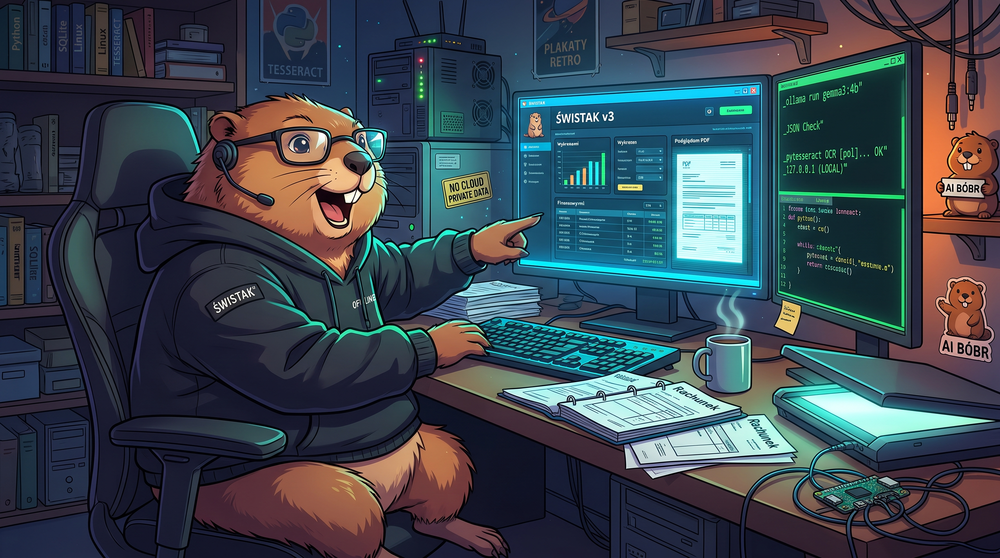

<div align="center">
  

  <h1>Świstak</h1>
  <p><strong>Twoje rachunki. Twój komputer. Twoja kontrola.</strong></p>
  <p>Lokalna aplikacja do porządkowania rachunków, odczytu dokumentów PDF i skanów oraz analizy danych przez AI uruchamianą na własnym komputerze.</p>
  <p><a href="#najważniejsze-możliwości">Możliwości</a> · <a href="#szybki-start">Instalacja</a> · <a href="#jak-to-działa">Obsługa</a> · <a href="#prywatność-i-bezpieczeństwo">Prywatność</a> · <a href="#licencja">Licencja</a></p>
</div>

---

> **W przygotowaniu: [Świstak Linux Beta 0.1.0 Beta 1](docs/LINUX_BETA.md).**
> Pakiet źródłowy (tar.gz) z instalatorem zależności i lokalnym startem.
> Nie jest to jeszcze niezależny od Pythona instalator systemowy.

> **Status: wersja rozwojowa.** Rejestr, import PDF, odczyt OCR, analiza przez lokalną Ollamę oraz języki PL/EN są już dostępne w kodzie. Nie ma jeszcze instalatora przeznaczonego dla użytkowników końcowych. Przed przetwarzaniem ważnych dokumentów zadbaj o kopię zapasową.

## Najważniejsze możliwości

| Obszar | Co potrafi Świstak? |
| --- | --- |
| **Rejestr rachunków** | Zapisuje dane dostawcy, kwotę, kategorię, daty i pozostałe informacje w lokalnej bazie **SQLite**. Osobna zakładka **Faktury** pokazuje zapisane rekordy w tabeli: sortowanie, wyszukiwanie, filtr statusu, suma widocznych i otwieranie do edycji. |
| **Archiwum PDF** | Przechowuje niezmienione oryginały, używa **SHA-256** do kontroli integralności i wykrywa ponowny import identycznego dokumentu. |
| **PDF i OCR** | Odczytuje warstwę tekstową PDF albo rozpoznaje skany przez **Tesseract**. Pozwala również zaznaczać i odczytywać fragment dokumentu. |
| **Kody QR** | Lokalnie dekoduje QR na stronach PDF, rozpoznaje wybrane polskie formaty płatności i umożliwia przeniesienie kwoty i konta do formularza po osobnym potwierdzeniu. |
| **Lokalna AI** | Analizuje tekst rachunku przez **Ollamę** i proponuje wartości pól formularza. |
| **Kontrola użytkownika** | Waliduje strukturę odpowiedzi AI i wybrane pola. **Dopiero człowiek zatwierdza dane i zapisuje rachunek.** |
| **Interfejs** | PySide6 / Qt, ciemny motyw, pionowy proces **Odczyt PDF → Analiza AI → Edycja danych → Faktura → Dokumenty → Faktury**, języki **polski i angielski** przełączane bez restartu. |

**Technologie:** Python · PySide6 / Qt · SQLite · pdfplumber · pypdfium2 · Tesseract OCR · ZXing-C++ · Ollama.

> **W testach: [Świstak Linux Beta — samodzielny pakiet binarny](docs/LINUX_BINARY_BETA.md).**
> To eksperymentalny pakiet PyInstaller dla Linuxa, uruchamiany bez
> instalowania Pythona i `.venv`. Nie jest jeszcze oficjalnym wydaniem;
> do publicznej dystrybucji wymagany jest przegląd licencji binarnych.
## Szybki start

Wymagania: **Python 3.11+**, Git oraz zależności z [requirements.txt](requirements.txt). Świstak jest obecnie uruchamiany z kodu źródłowego.

### Linux

Na Ubuntu/Debian zainstaluj Tesseract z językami polskim i angielskim:

```bash
sudo apt install tesseract-ocr tesseract-ocr-pol tesseract-ocr-eng
```

Następnie:

```bash
git clone https://github.com/DarkZachi83/Swistak.git
cd Swistak
python3 -m venv .venv
.venv/bin/python -m pip install -r requirements.txt
./uruchom.sh
```

Na innych dystrybucjach skorzystaj z własnego menedżera pakietów. **Poppler nie jest wymagany** do standardowego odczytu OCR.

### Windows

Zainstaluj Python, Git i Tesseract OCR z polskimi danymi językowymi. Tesseract musi być dostępny w `PATH`. W PowerShell:

```powershell
git clone https://github.com/DarkZachi83/Swistak.git
cd Swistak
py -3 -m venv .venv
.\.venv\Scripts\python.exe -m pip install -r requirements.txt
.\.venv\Scripts\python.exe main.py
```

### Lokalny model AI — opcjonalny

Do ręcznej obsługi rachunków **nie trzeba uruchamiać Ollamy**. Aby używać zakładki **Analiza AI**, zainstaluj ją osobno, pobierz lokalny model i sprawdź jego dostępność:

```bash
ollama pull gemma3:4b
ollama list
```

Model `gemma3:4b` jest modelem testowym; wymagania pamięci i szybkość działania zależą od komputera. Domyślny model można skonfigurować w menu **Ustawienia**.

## Analiza AI — DANE i AGENT

Przycisk **Szukaj modeli lokalnych…** w karcie **AGENT** wyświetla nazwy modeli dostępnych w uruchomionej Ollamie oraz osobno modele GGUF i wpisy magazynów znalezione w znanych katalogach (mechanizm inspirowany AI Bobrem). **Tylko modele z listy lokalnego API Ollamy można od razu wybrać**. Wybrany model jest zapamiętywany w ustawieniach; skan dysku nie uruchamia modeli, nie pobiera ich ani nie wysyła faktur przez sieć. Modele z LM Studio, Hugging Face i innych źródeł wymagają uprzedniego udostępnienia ich Ollamie.

W karcie **DANE** pod tabelą znajduje się pasek pracy Agenta. Podczas generowania przez Ollamę pokazuje animację bez sztucznych procentów i rzeczywisty etap (przygotowanie → odpowiedź Ollamy → walidacja); po sukcesie pokazuje 100%. Zatrzymanie lub błąd wyłącza pasek. 

Zakładka **Analiza AI** dzieli prawy panel na dwie karty: **DANE** (tabela pól, komentarze, walidacja, przyciski akcji i przycisk INFO) oraz **AGENT** (model Ollama, wybrany wzorzec i wskazówki). Podwójne kliknięcie kolumny **Komentarz** umożliwia edycję wskazówki konkretnego pola. Wskazówki te służą do przygotowania wzorca przy jego późniejszym zatwierdzaniu — nie zmieniają w locie polecenia bieżącej analizy.

## Kategorie i porządek w statystykach

W zakładce **Analiza AI → DANE** oraz w **Edycji danych** przycisk wyboru/dodawania kategorii otwiera listę istniejących pozycji z liczbą przypisanych faktur. Nowa nazwa otrzymuje podpowiedzi o podobnych kategoriach; ich przypadkowe dublowanie jest blokowane, a świadome stworzenie podobnej wymaga osobnego potwierdzenia. Opcja **Scal duplikaty…** pozwala przenieść przypisania z błędnej kategorii do właściwej, po potwierdzeniu. Operacja jest transakcyjna w SQLite; oryginalne faktury i kwoty nie są zmieniane. Podstawowych kategorii nie można wycofać. Scalanie jest blokowane, jeśli zapisany wzorzec nadal wskazuje kategorię źródłową — taki wzorzec trzeba najpierw zaktualizować. Przed scalaniem rzeczywistych danych wykonaj kopię całego katalogu danych po zamknięciu Świstaka.

## Jak to działa

1. **Importuj PDF** — dokument trafia do prywatnego archiwum, a Świstak pokazuje jego podgląd.
2. **Odczytaj dokument** — w zakładce **Odczyt PDF** uruchom odczyt całego dokumentu albo zaznaczonego fragmentu. Opcjonalnie kliknij **Odczytaj QR**, sprawdź wyświetlone dane i świadomie przenieś kwotę oraz numer konta.
3. **Uruchom lokalną analizę AI** — w zakładce **Analiza AI** poproś Ollamę o propozycje pól rachunku.
4. **Edytuj dane** — przenieś zatwierdzone propozycje do etapu **Edycja danych**, porównaj z PDF i popraw wartości. Pola można także wypełnić ręcznie, bez Ollamy.
5. **Zatwierdź fakturę** — w etapie **Faktura** sprawdź podsumowanie i dopiero wtedy kliknij **Zapisz fakturę**. Wróć do zapisanej faktury przez **Faktury** (tabela i filtry); w **Dokumentach** pozostaje lista wszystkich PDF-ów.
6. **Opcjonalnie ucz Świstaka** — po zapisie wybierz **Utwórz wzorzec faktury**. Sprawdź proponowany JSON z regułami i zatwierdź go osobno. Kolejne faktury będą rozpoznawane po NIP-ie sprzedawcy, nazwie i układzie, a Gemma dostanie zatwierdzone wskazówki. Zapis wzorca **nigdy nie jest automatyczny**.

Obraz wyświetla się z lokalnego pliku
`assets/about/swistak-o-programie.jpeg` (gdy jest dostępny) lub domyślnie
`assets/branding/swistak-banner.jpeg`. Obrazy są w formacie JPEG; okno
zachowuje ostrość również na ekranach HiDPI.
[Opis implementacji](docs/OKNO_O_PROGRAMIE.md).

Dokumentacja wzorców: **[Inteligentne wzorce faktur — JSON i nauka na poprawkach](docs/WZORCE_FAKTUR.md)**.

Więcej informacji: [odczyt QR](docs/KODY_QR.md) · [analiza przez Ollamę](docs/ETAP_3_OLLAMA.md) · [PDFium i OCR](docs/PDFIUM_OCR_BENCHMARK.md) · [języki](docs/JEZYKI.md).

## Prywatność i bezpieczeństwo

- **Dokumenty i baza danych pozostają lokalnie** — nie są przesyłane na GitHub.
- Analiza AI korzysta z **lokalnej usługi Ollama**. Brak modelu nie powoduje automatycznego wysłania rachunku do chmury.
- Archiwum przechowuje oryginalne PDF-y bez modyfikacji i weryfikuje je za pomocą SHA-256.
- **Pełna funkcja tworzenia i przywracania kopii zapasowych jest planowana.** Obecnie wykonuj kopię całego katalogu danych po zamknięciu programu. Przy migracji schematu aplikacja tworzy dodatkowo kopię samej bazy SQLite.
- Nie publikuj prawdziwych rachunków, plików bazy ani zrzutów pokazujących prywatne dane finansowe.

| System | Domyślny katalog danych |
| --- | --- |
| Linux | `~/.local/share/Swistak/` lub `$XDG_DATA_HOME/Swistak/` |
| Windows | `%LOCALAPPDATA%\Swistak\` |
| macOS | `~/Library/Application Support/Swistak/` |

Katalog można zmienić zmienną `SWISTAK_DATA_DIR`. Ustawienia interfejsu i modelu AI zapisywane są oddzielnie od SQLite.

## Testowanie i rozwój

Na Linuxie uruchom **oddzielną bazę testową**:

```bash
./uruchom.sh --test
```

Skrypt działa również w katalogach `git worktree`, które nie mają własnego `.venv`: może wykorzystać środowisko Pythona z głównego drzewa Git. **Bez flagi `--test` aplikacja używa standardowej bazy użytkownika.**

Testy automatyczne:

```bash
QT_QPA_PLATFORM=offscreen .venv/bin/python -m unittest discover -s testy -v
```

Dokumentacja projektu: [plan etapów](docs/PLAN.md) · [dobór modelu z pomocą AI Bobra](docs/WYBOR_MODELU_AI_BOBR.md) · [okno „O programie”](docs/OKNO_O_PROGRAMIE.md).

Wybór lokalnego modelu można wspomóc projektem [AI Bóbr](https://github.com/DarkZachi83/Bobr); **AI Bóbr nie jest obowiązkową zależnością Świstaka**.

## Licencja

Copyright © 2026 **Rafał Zacharski**.

Aktualny kod jest udostępniany na warunkach **[PolyForm Noncommercial 1.0.0](LICENSE)**. To licencja *source-available* dopuszczająca określone zastosowania niekomercyjne — **nie** licencja open source zatwierdzona przez OSI. Użytkowanie komercyjne wymaga odrębnej zgody/licencji właściciela praw.

**Świstak Home / Business** to planowany model dystrybucji, a nie obecnie gotowe edycje ani opublikowany cennik. Wcześniejsze wersje udostępnione na **GPL-3.0-only** zachowują dotychczasowe warunki.

Szczegóły: [model licencjonowania](docs/LICENCJONOWANIE.md) · [licencje zależności](THIRD_PARTY_LICENSES.md) · [rejestr zależności](licencje/rejestr.json).
